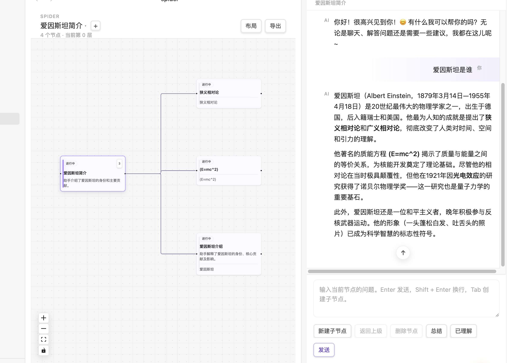
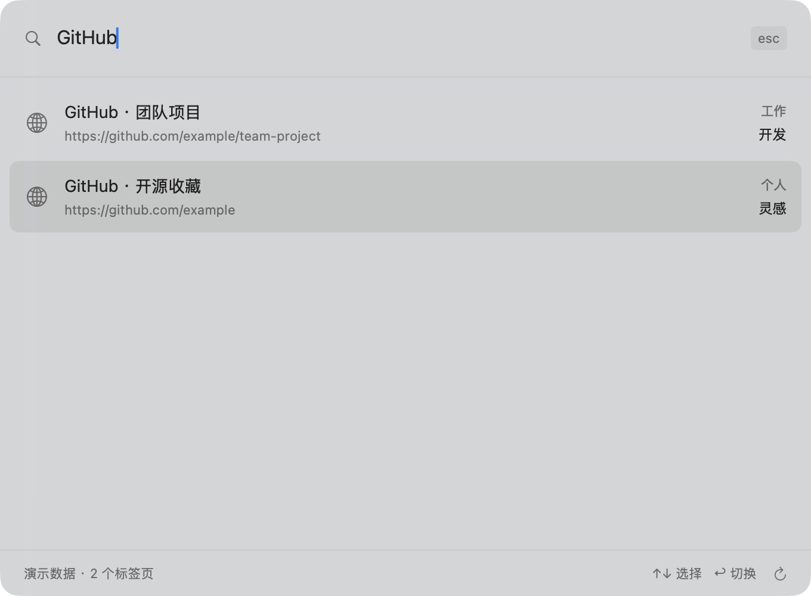

  

  <strong>Building AI tools for learning and everyday workflows.</strong> 
  把学习、知识管理和日常工作流里的需求，做成插件、应用和 Agent 工具。

  <a href="#selected-projects">Projects</a> ·
  <a href="#toolbox">Toolbox</a> ·
  <a href="mailto:111pointer111@gmail.com">111pointer111@gmail.com</a>

## Selected projects

### Spider

在 Obsidian 里把 AI 对话展开成知识图谱。选中文字，按下 `Tab` 继续追问，再将探索结果导出为 Canvas、Markdown 或 Mermaid。

`TypeScript` · `React` · `React Flow` · `Obsidian`

[Source](https://github.com/111pointer111/spider) · [Releases](https://github.com/111pointer111/spider/releases)

  
查看界面 · 分支对话与知识图谱

  

    
  

### Ego Tab Search

一个快捷键搜索散落在不同账号与空间里的浏览器标签页，直接回到原页面。使用 SwiftUI 构建的原生 macOS 菜单栏工具。

`Swift` · `SwiftUI` · `macOS` · `CDP`

[Source](https://github.com/111pointer111/ego-lite-tab-search) · [Releases](https://github.com/111pointer111/ego-lite-tab-search/releases)

  
查看界面 · 跨账号标签页搜索

  

    
  

  
原生界面截图，使用项目公开演示数据。

### Awesome Prompts Manager

集中搜索、备注和修改多个业务的 AI 提示词，保存后写回原业务并回读确认。附带接入 Skill 与 Python、TypeScript 示例。

`TypeScript` · `React` · `Node.js` · `SQLite` · `Three.js`

[Source](https://github.com/111pointer111/awesome-prompts-manager) · [Integration examples](https://github.com/111pointer111/awesome-prompts-manager/tree/main/examples)

## More projects

- **Mini-Chat** — 实时聊天、AI 对话、知识库 RAG 与 MCP 工具集成。[Source](https://github.com/111pointer111/mini-chat)
- **Claude Marketplace** — Claude Code 插件与可复用的 Skills，包含苏格拉底式教学工具。[Source](https://github.com/111pointer111/claude-marketplace)
- **摸鱼签** — 用 Flutter 做的趣味小应用，包含卡片翻转与桌面小组件。[Source](https://github.com/111pointer111/moyu_sign)

## Toolbox

**Languages** &nbsp; `TypeScript` · `Python` · `Swift` · `Dart`

**Build with** &nbsp; `React` · `Node.js` · `SwiftUI` · `Flutter` · `Obsidian` · `MCP`

## Get in touch

欢迎交流 AI 工具、知识管理、Agent 工作流和效率应用。

**[111pointer111@gmail.com](mailto:111pointer111@gmail.com)**
